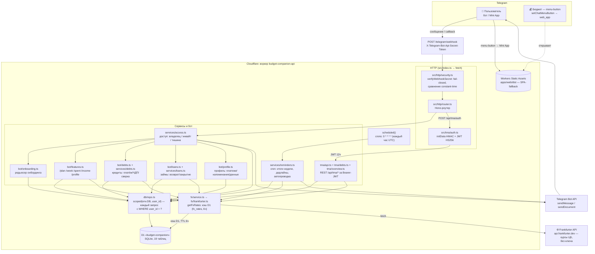
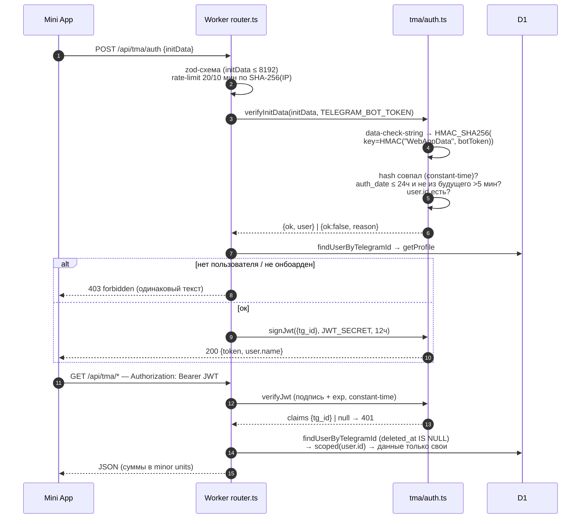
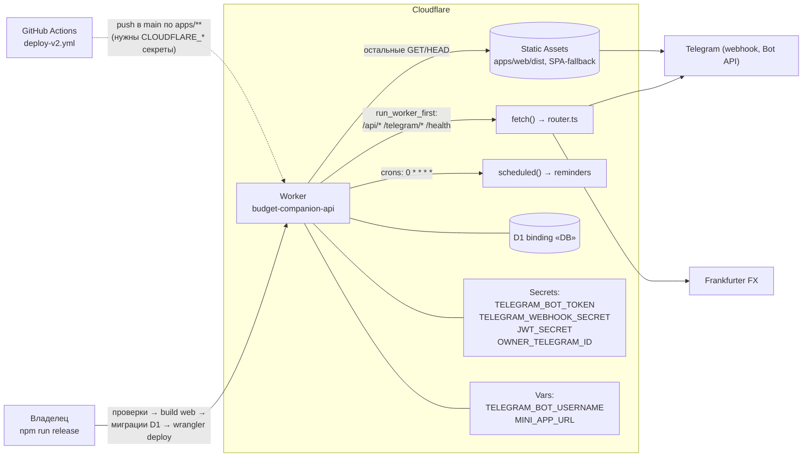

# Архитектура v2 — Cloudflare Worker + D1 + Mini App

Статус: **в проде — единственный стек** (миграция завершена шагом 9,
legacy удалён — см. [ADR-0001](adr/0001-platform-and-architecture.md)).
Документ описывает `apps/api` и `apps/web`.

## Обзор системы

Один Cloudflare Worker (`budget-companion-api`) обслуживает три входа:
webhook Telegram-бота, REST API Mini App и статику самого Mini App.
Хранилище — D1 (SQLite). Фоновая работа — часовой cron.

**Правила потоков:**

- Webhook отклоняется до любой обработки, если `TELEGRAM_WEBHOOK_SECRET` не задан
  (fail-closed, 503) или заголовок не совпал (401, сравнение дайджестов SHA-256
  без раннего выхода). Дубликаты `update_id` отсекаются таблицей
  `processed_updates`. Незнакомым отправителям бот не отвечает и ничего не пишет.
- Все пользовательские данные читаются и пишутся только через
  `scoped(env.DB, user_id)` — сырые `db.prepare` вне `db/repo.ts` запрещены
  (правило S5, тесты «A не видит B»).
- Cron раз в час прогоняет `services/reminders.ts` по списку онбоарденных
  пользователей с включёнными флагами: воскресный итог недели (окно
  20:00–23:59 локально), напоминания о платежах за 2 дня и сроках займов
  (окно 10:00–21:59 локально), автопроводка ежемесячных платежей и кредитов.
  Идемпотентность — `reminder_log` (claim `INSERT OR IGNORE`); заодно чистятся
  `processed_updates` (старше 7 дней) и `reminder_log` (старше ~400 дней).

## Аутентификация Mini App

JWT живёт только в памяти SPA (не в localStorage); при 401 — один повторный
`POST /api/tma/auth` и один повтор запроса, дальше — экран «Нет доступа».

Ключевые точки: удалённый пользователь (`deleted_at`) получает 403 даже с живым
JWT; невалидный JWT → 401 на любом `/api/tma/*`; токенов в URL нет — только
заголовок `Authorization`.

## Слой данных (D1)

18 таблиц, миграции `apps/api/migrations/0001–0014` — **иммутабельны**: изменения
только новыми файлами `NNNN_name.sql`; применение —
`wrangler d1 migrations apply DB [--local|--remote]` (в `npm run release`
уже встроено, при провале миграций деплой не идёт).

| Таблица | Миграция | Назначение |
|---------|----------|------------|
| `users` | 0001 | Пользователи: `telegram_id` UNIQUE, `role` owner/member, `deleted_at` (soft-delete) |
| `invites` | 0001 | Одноразовые приглашения: хранится только `code_hash` (SHA-256), `expires_at` 48ч, лимит 10 активных |
| `consents` | 0001 | Согласия пользователя (`terms` и т.п.) |
| `audit_log` | 0001 | Журнал действий доступа (`meta` — JSON без секретов и кодов) |
| `processed_updates` | 0002 | Дедуп webhook по `update_id` (PK); очистка старше 7 дней каждый cron-тик |
| `profiles` | 0003, 0005, 0015 | Профиль: валюты (включая `expense_currency` — дефолт трат), `timezone`, типичный доход, норма повседневных, флаги `reminders_weekly`/`reminders_payments` |
| `commitments` | 0003, 0004 | Регулярные платежи: сумма, валюта, `due_day`, `active` (⏸) |
| `weekly_expenses` | 0003 | Траты: `spent_on` (локальная дата), сумма, заметка; `UNIQUE(user_id, source_key)` |
| `conversation_state` | 0003 | Состояние диалога бота (шаг + JSON), TTL 24ч на уровне кода |
| `fx_rates` | 0003 | Глобальный кэш курсов `per_usd` (TTL 6ч); доступ — `fxRepo`, вне scoped |
| `income_entries` | 0004 | Факт дохода по месяцам (`month` = YYYY-MM в таймзоне) |
| `reminder_log` | 0005 | Идемпотентность cron-отправок и рейт-лимит `/export` (claim по `kind+key`) |
| `rate_limit` | 0006 | Окно 10 мин для `POST /api/tma/auth`; ключ — SHA-256(IP) |
| `debts` | 0007, 0011 | Кредиты/ипотеки: начальные параметры + `source_key` (идемпотентное создание) |
| `debt_events` | 0007, 0009 | Журнал append-only: `payment`/`prepay`/`reconcile`, режим ЧДП `mode`, `source` manual/auto |
| `loans` | 0008, 0011 | Личные займы: `direction` owe/owed, `due_on`, `closed_at` |
| `loan_events` | 0008 | Журнал возвратов (`repay`), append-only |
| `commitment_payments` | 0010 | Журнал оплат платежей (manual/auto — автопроводка cron'ом) |
| `categories` | 0014 | Категории трат: пресеты (`preset_key`) + свои, `archived`, `sort`; `weekly_expenses.category_id`, `income_entries.received_on` |

**Правила:**

- **Деньги — `INTEGER` в минорных единицах** (копейки/центы); домен считает во
  float, конверсия `toMinor`/`fromMinor` — на границе репозитория.
- **Изоляция tenant:** каждая таблица с пользовательскими данными имеет
  `user_id`; доступ — только через `scoped(db, userId)`, где каждый запрос
  содержит `WHERE user_id = ?`. Мутации по id — `WHERE id=? AND user_id=?`
  (чужой id → 404 в REST / молча в боте). Глобальные таблицы без user-data —
  `fx_rates`, `processed_updates`, `rate_limit` и access-контур — через
  `fxRepo`/`accessRepo`.
- **Идемпотентность записей:** `source_key` (`tg:<update_id>`,
  `tma:<client_id>`, `auto:<объект>:<период>`) + `UNIQUE(user_id, source_key)`
  на журналах и справочниках — повторная доставка webhook или сетевой ретрай
  Mini App не создают дублей.
- **Событийная модель долгов:** `debts`/`loans` хранят начальные параметры,
  текущий остаток вычисляется replay() по журналу событий — пересчёт
  идемпотентен и самовосстанавливается (как `DebtEngine` в v1).

## Топология деплоя

Один воркер = API + SPA + cron. Секреты — только `wrangler secret put`;
локально — `.dev.vars` (в `.gitignore`).

- **`run_worker_first = ["/api/*", "/telegram/*", "/health"]`** — API и webhook
  никогда не перехватываются SPA-fallback'ом; не-API GET уходит в ассеты,
  где `not_found_handling = "single-page-application"` отдаёт `index.html`.
- **Сборка перед деплоем:** `scripts/release.mjs` собирает `apps/web` до
  `wrangler deploy` — иначе в assets уедет устаревшая SPA.
- **Cron:** `wrangler.toml [triggers] crons = ["0 * * * *"]` — каждый час UTC;
  локальное время каждого пользователя считается по его `profiles.timezone`.
- **Переменные:** `TELEGRAM_BOT_USERNAME` (ссылки-инвайты `t.me/<bot>?start=<код>`)
  и `MINI_APP_URL` (цель menu-button) — несекретные, в `[vars]`.

## Куда смотреть дальше

| Тема | Документ |
|------|----------|
| Разработка, деплой, чеклисты вех | [v2-development.md](v2-development.md) |
| Навигация бота (источник истины экранов) | [ux/navigation.md](ux/navigation.md) |
| Гид пользователя | [USER_GUIDE.md](USER_GUIDE.md) |
| Модель угроз и политика секретов | [../SECURITY.md](../SECURITY.md) — раздел v2 |
| Решение о платформе и план миграции | [adr/0001-platform-and-architecture.md](adr/0001-platform-and-architecture.md) |
| Аудит v2 (2026-10-28) | [../AUDIT_REPORT.md](../AUDIT_REPORT.md) |

## Шифрование данных at rest

`src/db/crypto.ts`: HKDF-SHA256(`DATA_KEY`, salt 'budget-companion/data/v1',
info 'user:<id>') → AES-GCM-256, формат `enc1:<b64url(iv||ct+tag)>`, AAD
`<table>.<col>:<userId>`. Спек зашифрованных колонок — `FIELDS` (суммы, имена,
заметки, `conversation_state.data`); остальное plaintext (даты, валюты, id, флаги —
нужны для WHERE/CAS). `repo.ts` шифрует бинды и дешифрует строки прозрачно для
вызывающих; cron (`services/encryption.ts` → `encryptBackfill`) дошифровывает
legacy-строки идемпотентными CAS-UPDATE'ами (≤200/таблицу/тик).
