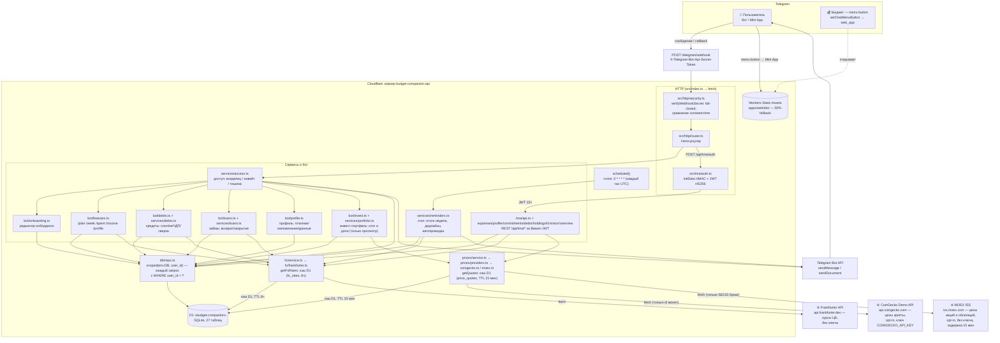
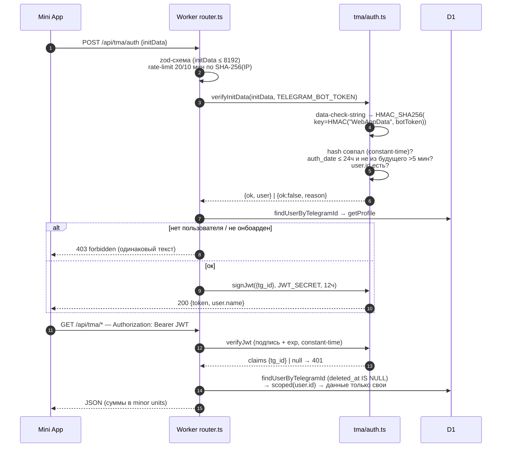
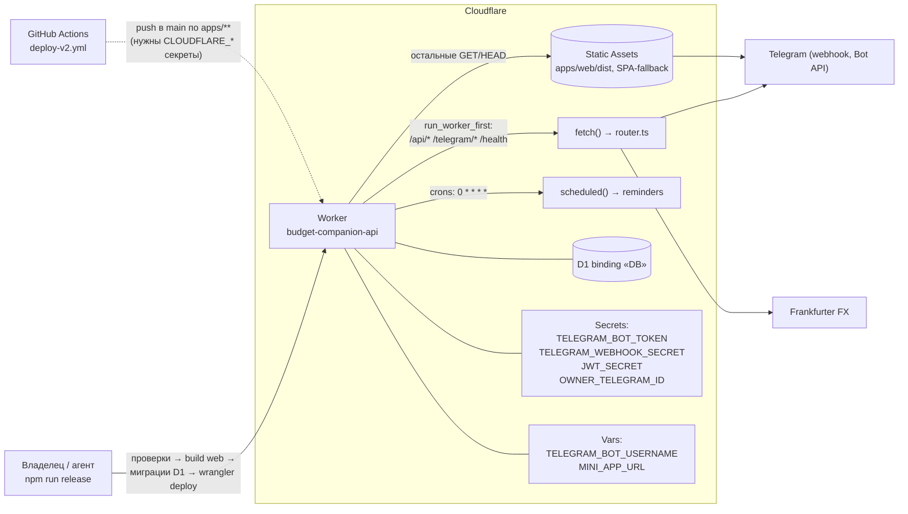

# Архитектура v2 — Cloudflare Worker + D1 + Mini App

Статус: **в проде — единственный стек** (миграция завершена шагом 9,
legacy удалён — см. [ADR-0001](adr/0001-platform-and-architecture.md)).
Документ описывает `apps/api` и `apps/web`.

## Обзор системы

Один Cloudflare Worker (`budget-companion-api`) обслуживает три входа:
webhook Telegram-бота, REST API Mini App и статику самого Mini App.
Хранилище — D1 (SQLite). Фоновая работа — часовой cron.

**Правила потоков:**

- Webhook отклоняется до любой обработки, если `TELEGRAM_WEBHOOK_SECRET` не задан
  (fail-closed, 503) или заголовок не совпал (401, сравнение дайджестов SHA-256
  без раннего выхода). Дубликаты `update_id` отсекаются таблицей
  `processed_updates`. Незнакомым отправителям бот не отвечает и ничего не пишет.
- Все пользовательские данные читаются и пишутся только через
  `scoped(env.DB, user_id)` — сырые `db.prepare` вне `db/repo.ts` запрещены
  (правило S5, тесты «A не видит B»).
- Cron раз в час прогоняет `services/reminders.ts` по списку онбоарденных
  пользователей с включёнными флагами: воскресный итог недели (окно
  20:00–23:59 локально), напоминания о платежах за 2 дня и сроках займов
  (окно 10:00–21:59 локально), автопроводка ежемесячных платежей и кредитов,
  дайджест месяца (последний локальный день ≥ часа окна, после автопроводки;
  catch-up 1-го числа до 12:00 за прошлый месяц; claim `digest` на `YYYY-MM`).
  Идемпотентность — `reminder_log` (claim `INSERT OR IGNORE`); заодно чистятся
  `processed_updates` (старше 7 дней) и `reminder_log` (старше ~400 дней).

## Аутентификация Mini App

JWT живёт только в памяти SPA (не в localStorage); при 401 — один повторный
`POST /api/tma/auth` и один повтор запроса, дальше — экран «Нет доступа».

Ключевые точки: удалённый пользователь (`deleted_at`) получает 403 даже с живым
JWT; невалидный JWT → 401 на любом `/api/tma/*`; токенов в URL нет — только
заголовок `Authorization`.

## Слой данных (D1)

27 таблиц, миграции `apps/api/migrations/0001–0026` — **иммутабельны**: изменения
только новыми файлами `NNNN_name.sql`; применение —
`wrangler d1 migrations apply DB [--local|--remote]` (в `npm run release`
уже встроено, при провале миграций деплой не идёт).

| Таблица | Миграция | Назначение |
|---------|----------|------------|
| `users` | 0001 | Пользователи: `telegram_id` UNIQUE, `role` owner/member, `deleted_at` (soft-delete) |
| `invites` | 0001 | Одноразовые приглашения: хранится только `code_hash` (SHA-256), `expires_at` 48ч, лимит 10 активных |
| `consents` | 0001 | Согласия пользователя (`terms` и т.п.) |
| `audit_log` | 0001 | Журнал действий доступа (`meta` — JSON без секретов и кодов) |
| `processed_updates` | 0002 | Дедуп webhook по `update_id` (PK); очистка старше 7 дней каждый cron-тик |
| `profiles` | 0003, 0005, 0015, 0023, 0024 | Профиль: валюты (включая `expense_currency` — дефолт трат), `timezone`, базовый доход (`income_minor`: >0 — явный, 0 — вычисляется из обязательств), бюджет повседневных, флаги `reminders_weekly`/`reminders_payments`/`reminders_digest` (0022)/`vision_enabled`/`fx_alerts_enabled`/`auto_prices_enabled` (0024, opt-in автоцен, DEFAULT 0); `invest_targets` (0023, `enc1:`) — цели распределения портфеля, JSON «вид → %» |
| `commitments` | 0003, 0004 | Регулярные платежи: сумма, валюта, `due_day`, `active` (⏸) |
| `weekly_expenses` | 0003 | Траты: `spent_on` (локальная дата), сумма, заметка; `UNIQUE(user_id, source_key)` |
| `conversation_state` | 0003 | Состояние диалога бота (шаг + JSON), TTL 24ч на уровне кода |
| `fx_rates` | 0003 | Глобальный кэш курсов `per_usd` (TTL 6ч); доступ — `fxRepo`, вне scoped |
| `income_entries` | 0004 | Факт дохода по месяцам (`month` = YYYY-MM в таймзоне) |
| `reminder_log` | 0005 | Идемпотентность cron-отправок и рейт-лимит `/export` (claim по `kind+key`) |
| `rate_limit` | 0006 | Окно 10 мин для `POST /api/tma/auth`; ключ — SHA-256(IP) |
| `debts` | 0007, 0011 | Кредиты/ипотеки: начальные параметры + `source_key` (идемпотентное создание) |
| `debt_events` | 0007, 0009 | Журнал append-only: `payment`/`prepay`/`reconcile`, режим ЧДП `mode`, `source` manual/auto |
| `loans` | 0008, 0011 | Личные займы: `direction` owe/owed, `due_on`, `closed_at` |
| `loan_events` | 0008 | Журнал возвратов (`repay`), append-only |
| `commitment_payments` | 0010 | Журнал оплат платежей (manual/auto — автопроводка cron'ом) |
| `commitment_changes` | 0021 | История изменений платежа «было → стало» (name/amount/currency/due_day/active/cadence), append-only; `old_val`/`new_val` — `enc1:`; пишется в `patchCommitment` |
| `exchanges` | 0013 | Журнал обменов валют: `rate`/`market_rate` в единицах to за 1 from |
| `households` | 0020 | Общий бюджет пары: единый недельный лимит (`enc1:`, ключ от `households.id`) |
| `household_members` | 0020 | Члены пары (≤2, юзер — максимум в одном), роль owner/member |
| `categories` | 0014 | Категории трат: пресеты (`preset_key`) + свои, `archived`, `sort`; `weekly_expenses.category_id`, `income_entries.received_on` |
| `holdings` | 0023, 0024, 0025, 0026 | Ручной инвест-портфель (T3a): вид `deposit`/`bond`/`crypto`/`stock`/`other`; `name`, `ticker`, `quantity`, `avg_price` (legacy), `invested` (0025, «потрачено всего», у старых строк NULL → quantity × avg_price при чтении), `price`, `amount_minor`, `rate`, `note` — `enc1:`; `currency`, `price_on`, `opened_on`, `matures_on` — plaintext; `auto_price` (0024, флаг «брать автоцену», DEFAULT 1) — plaintext; `source_key` (`tma:<client_id>`) — идемпотентность создания; не больше 50 позиций на пользователя. Журнал (0026): `realized_minor` (`enc1:`, кэш свёртки), `closed_on` (дата полной продажи, plaintext), `hidden` (DEFAULT 0), `trade_rev` (версия CAS) |
| `holding_trades` | 0026 | Журнал покупок/продаж позиции (T3d1): `side` `buy`/`sell`, `is_initial` (начальная запись старой позиции), `traded_on` (`YYYY-MM-DD`, plaintext), `source_key` (`tma:<client_id>` / `init:<holding_id>`, уникален в пределах `user_id`); `quantity`, `amount` (с комиссией), `note` — `enc1:`, десятичные строки; индекс `(user_id, holding_id, traded_on, id)` |
| `price_quotes` | 0024 | Глобальный кэш котировок автоцен (T3b): `source`, `asset_id` (id монеты CoinGecko), `vs_currency`, `price` (десятичная строка), `as_of` (время котировки у провайдера), `fetched_at` (для TTL 15 мин); PK `(source, asset_id, vs_currency)`; **без `user_id`** и без шифрования — не пользовательские данные; доступ — `priceRepo`, вне scoped |
| `price_provider_state` | 0024 | Состояние провайдера цен (по `source`): `blocked_until` — пауза после сбоя (429 → 10 мин, 401/403 → 6 ч, прочее → 2 мин), `last_status` — HTTP-код без тела ответа; глобальная, вне scoped |

**Правила:**

- **Деньги — `INTEGER` в минорных единицах** (копейки/центы); домен считает во
  float, конверсия `toMinor`/`fromMinor` — на границе репозитория.
- **Исключение — инвест-позиции (правило 21):** количество и цены `holdings` — канонические десятичные строки (`domain/decimal.ts`, BigInt); через `toMinor` они не переводятся. Суммы вкладов и «другого» — `amount_minor` в minor units валюты позиции.
- **Изоляция tenant:** каждая таблица с пользовательскими данными имеет
  `user_id`; доступ — только через `scoped(db, userId)`, где каждый запрос
  содержит `WHERE user_id = ?`. Мутации по id — `WHERE id=? AND user_id=?`
  (чужой id → 404 в REST / молча в боте). Глобальные таблицы без user-data —
  `fx_rates`, `price_quotes`, `price_provider_state`, `processed_updates`, `rate_limit` и access-контур — через
  `fxRepo`/`priceRepo`/`accessRepo`.
- **Идемпотентность записей:** `source_key` (`tg:<update_id>`,
  `tma:<client_id>`, `auto:<объект>:<период>`) + `UNIQUE(user_id, source_key)`
  на журналах и справочниках — повторная доставка webhook или сетевой ретрай
  Mini App не создают дублей.
- **Событийная модель долгов:** `debts`/`loans` хранят начальные параметры,
  текущий остаток вычисляется replay() по журналу событий — пересчёт
  идемпотентен и самовосстанавливается (как `DebtEngine` в v1).

## Инвестиции (T3a): домен и сервисы

Ручной портфель — этап 1 шага 10 (T3a). Автоцены крипты — этап 2 (T3b, см. ниже). Автоцены акций и облигаций Мосбиржи — T3c (см. раздел ниже). Журнал покупок/продаж — T3d1 (см. раздел ниже); напоминания о погашении и купоны — T3d2/T3d3 (впереди).

- `domain/decimal.ts` — точная десятичная арифметика на BigInt. Количество и цена — каноническая строка (до 12 цифр до точки, до 8 после, больше нуля). `mulToMinor` — qty × price в minor units с округлением half-up; переполнение (> 1e9 major) — `TOO_LARGE`.
- `domain/portfolio.ts` — чистые функции без I/O, «сегодня» передаётся параметром: стоимость позиции (qty × price для облигаций, крипты и акций; сумма для вклада и «другого»), «потрачено» (`investedMinor`: `invested`, а у старых строк — qty × avg_price), результат `pnlMinor` = стоимость сейчас − потрачено, `valuation` — оценка без цены по сумме покупки (`valued_at_cost`, P&L = 0), «цена устарела» (старше 30 дней), «≈ начислено» по вкладу (простые проценты), доли по видам, валидация целей (целые проценты, сумма 100), `dcaTargetsFrom` — веса DCA для плана.
- `services/portfolio.ts` — `portfolioView`: итог в валюте бюджета. Курс запрашивается по каждой валюте отдельно (толерантно): валюта без курса не валит экран — позиция видна, в итог не входит, код валюты попадает в `missing_rates`. Если курс валюты бюджета недоступен, итог не считается (`null`).
- `bot/invest.ts` (`/invest`, экран INVEST — только просмотр) и `tma/holdings.ts` (`/api/tma/holdings`, CRUD) используют один и тот же `portfolioView`. Мутации по id — `WHERE id=? AND user_id=?`; партнёру по household позиции не отдаются.
- Цели распределения — `profiles.invest_targets` (`GET`/`PATCH /api/tma/profile`). По ним план делит долю бонуса «в DCA» (`bonus.dca_split` в Mini App, строка «DCA → …» в `/plan` бота) вместо прежней заглушки `{USD:1}`.

## Журнал покупок/продаж (T3d1): сделки позиции

Миграция 0026: таблица `holding_trades` и колонки кэша в `holdings` (`realized_minor`, `closed_on`, `hidden`, `trade_rev`).
Журнал — источник истины; `holdings.quantity`/`invested` — кэш свёртки. Сделка только в валюте позиции.

- `domain/trades.ts` — чистые функции без I/O: `applyTrade` (покупка добавляет количество и «потрачено»; продажа — прибыль по средней цене: себестоимость куска = q × invested / quantity, комиссия внутри суммы), `foldTrades` (свёртка журнала: начальная запись, затем по дате, затем по id), `startingTrade` (начальная запись старой позиции из `invested` или quantity × avg_price), `avgCost`. Арифметика — `domain/decimal.ts` (BigInt, строки).
- `services/trades.ts` — `addTrade`, `removeTrade`, `tradesView`. Инкремент от кэша позиции, если дата не раньше последней сделки; иначе полная свёртка журнала. Ошибки (409): `oversell`, `invested_required`, `initial_locked` (начальную запись нельзя удалить, пока есть другие), `limit` (≤200 сделок на позицию), `trades_unsupported` (только крипта, акции, облигации).
- `db/scoped/trades.ts` — `commitTrades(holdingId, expectedRev, {inserts, deleteIds}, state)`: один `db.batch` — вставки/удаления сделок и обновление `holdings` (quantity, invested, `realized_minor`, `closed_on`, `trade_rev + 1`) с условием `trade_rev = expected`. Версия не совпала — ничего не записано, `conflict` (409). Дубль `source_key` — UNIQUE, batch откатывается, ответ `duplicate: true`.
- `closed_on` — дата полной продажи (количество стало 0). Покупка снимает её и сбрасывает `hidden`. `hidden` ставится только у закрытой позиции (иначе 409 `not_closed`).
- **Блокировка ручных правок:** при наличии сделок `PATCH /api/tma/holdings/:id` с `quantity`/`invested`/`avg_price`/`currency` → 409 `trades_locked`. Название, тикер, цена, заметка и ставка правятся как раньше.
- Маршруты (`tma/trades.ts`, регистрация — `http/router.ts`, все за `tmaAuth`): `GET /api/tma/holdings/:id/trades` (сделки, результат по каждой продаже, `limit`); `POST /api/tma/holdings/:id/trades` (`side`, `quantity`, `amount` — строками; `traded_on` — не позже сегодня, по умолчанию сегодня; `client_id` — идемпотентность; 201 или `duplicate: true`); `DELETE /api/tma/holdings/:id/trades/:tradeId`. Схема строгая (`strict`): `user_id` и `holding_id` из тела не принимаются. Чужая позиция или сделка → 404.
- **Приватность:** `quantity`, `amount`, `note` сделок — `enc1:` (`FIELDS`, `holding_trades`); по ним нет WHERE и SQL-агрегатов. Партнёру по household сделки и позиции не отдаются (`householdSummary` их не содержит). Сделки не уходят во внешние провайдеры цен.
- **Экспорт и удаление:** `/export` — `schema_version: 10`, раздел `holding_trades` (служебные `source_key` и `trade_rev` не экспортируются). `/delete_me` удаляет `holding_trades` раньше `holdings`; удаление позиции убирает и её сделки.
- Бот сделок не ведёт; `/invest` показывает число закрытых позиций («Закрытых: N»). В Mini App — форма «Покупка/Продажа» (`apps/web/src/screens/invest-trade.tsx`).
- Тесты: `test/domain/trades.test.ts` (свёртка, средняя цена, 8 знаков), `test/trades.test.ts` (шифрование, «A не видит и не пишет сделки B», гонки, блокировки, лимит, экспорт, бот).

## Автоцены крипты (T3b): слой `prices/`

Цена крипты подставляется сама из CoinGecko; ручная цена при этом не меняется. Слой — `apps/api/src/prices/`:

- `prices/provider.ts` — интерфейс `PriceProvider` (пакетный `latest(ids, vs)`), ошибка `PriceUnavailable(status?)`.
- `prices/coingecko.ts` — CoinGecko Demo: `GET https://api.coingecko.com/api/v3/simple/price` (`ids`, `vs_currencies`, `precision=full`, `include_last_updated_at`), ключ — заголовок `x-cg-demo-api-key` (не в URL и не в логах), таймаут 5 с. Ответ проверяется zod; кривой JSON → `PriceUnavailable`. Константа `COINGECKO_ATTRIBUTION` («Data provided by CoinGecko» → https://www.coingecko.com/en/api) выводится в Mini App и боте.
- `prices/service.ts` — `getQuotes(db, provider, refs, now)`: сначала `price_quotes` (TTL 15 мин), внешний запрос только по ненайденным/просроченным монетам и одним пакетом; сбой → `price_provider_state` (пауза 429 → 10 мин, 401/403 → 6 ч, прочее → 2 мин), до её окончания внешних запросов нет; запасной кэш не старше 7 дней (`stale: true`). В лог — только код статуса и число id.
- `domain/coins.ts` — белый список `COINS` (тикер → id монеты CoinGecko, 31 тикер). Символы на CoinGecko не уникальны, поэтому тикер вне списка — только ручная цена. `coinIdFor(kind, ticker)` — id только для `kind='crypto'`.
- `domain/portfolio.ts` — `effectivePrice(h, quote, today, nowIso, enabled)`: чистая функция. Авто ≤24 ч бьёт ручную; авто 1–7 дней — только если новее ручной (`price_on`); старше 7 дней — не используется. Флаги `enabled=false` (профиль выкл), `auto_price=0` (позиция выкл), не-крипта или нет котировки → ручная.
- `services/portfolio.ts` — `portfolioView(…, prices, now)`: собирает ссылки «монета + валюта позиции» и вызывает провайдера **только** если включён `profiles.auto_prices_enabled` и настроен провайдер; иначе ноль внешних запросов. Позиция в валюте, для которой CoinGecko не отдал котировку, получает `auto_note: ccy_unsupported` и остаётся на ручной цене.

**Точка подключения:** `env.COINGECKO_API_KEY` (секрет). Нет ключа → `pricesFor(env)` = `null` → `available: false`, экран работает как в T3a. Тесты подменяют провайдер через `RouterDeps.prices`.

**Приватность.** Наружу уходят только id монет и валюта котировки; имена позиций, суммы, количества и `user_id` — нет. `price_quotes` общий для всех пользователей (как `fx_rates`) и не содержит данных пользователя; поэтому не входит в `FIELDS` и не участвует в `/delete_me`.

**Экспорт.** `/export` — `schema_version: 9`: в `holdings` есть `invested` (0025) и `auto_price`, в `profile` — `auto_prices_enabled`. С T3d1 — `schema_version: 10` (раздел `holding_trades`, см. ниже).

## Автоцены акций и облигаций Мосбиржи (T3c): MOEX ISS

Тот же слой `prices/` и тот же общий кэш `price_quotes` (без миграций: `source='moex'`). Тумблер — общий `profiles.auto_prices_enabled` («Автоцены»).

- `prices/moex.ts` — `createMoex()`: `GET https://iss.moex.com/iss/engines/stock/markets/{shares|bonds}/securities.json` (пакетно по SECID, до 10 за запрос, без указания борда — строки по всем бордам), таймаут 5 с, ответ проверяет zod, кривой JSON → `PriceUnavailable`. Поиск — `search(q, kind)`: `GET /iss/securities.json` (от 2 символов, только торгуемые бумаги своего рынка), затем один пакетный запрос на уточнение валюты и борда (всего ≤2 внешних запроса). Константа `MOEX_ATTRIBUTION` («Цены акций и облигаций: Московская биржа, задержка 15 мин» → https://www.moex.com) выводится в Mini App и боте. Ключа нет.
- `prices/providers.ts` — `resolveProviders(env)`: `coingecko` (есть `COINGECKO_API_KEY`) и `moex` (`env.MOEX_PRICES === 'on'`); иначе `null` → ноль внешних запросов. `makePriceSources` в `prices/service.ts` отдаёт `PriceSources` по видам (`coingecko`, `moex`).
- `domain/moex.ts` — чистая логика без I/O: белые списки бордов `MOEX_BOARDS` (акции TQBR/TQTF/TQIF; облигации TQOB/TQCB/TQIR/TQOD/TQOY; приоритет по порядку), `pickMoexQuote` (LAST → LCURRENTPRICE → MARKETPRICE → PREVPRICE, иначе PREVPRICE с PREVDATE), `bondUnitPrice` = `% × номинал / 100 + НКД` на BigInt (`decimal.ts`), `mskToIso`, `moexCcy` (SUR → RUB). Облигацию борд пропускается, если валюта расчётов борда ≠ валюте номинала (FACEUNIT). Цена облигации в валюте не конвертируется.
- `domain/price-ref.ts` — `priceRefFor(kind, ticker)`: крипта из белого списка → CoinGecko; `stock`/`bond` с корректным SECID (`holdings.ticker`) → MOEX. Вне этого — только ручная цена.
- `domain/portfolio.ts` — `MOEX_POLICY` (свежая ≤96 ч — выходные и праздники; запасной кэш ≤14 дн) и `CRYPTO_POLICY` (≤24 ч, ≤7 дн). Приоритет тот же, что у крипты: свежая автоцена бьёт ручную, ручная не перезаписывается.
- `services/portfolio.ts` — котировка в валюте, отличной от валюты позиции, не используется: `auto_note: ccy_mismatch`, позиция на ручной цене или (без неё) по сумме покупки. Атрибуция MOEX попадает в `auto.attributions` только если есть позиции с MOEX-источником.
- `tma/holdings.ts` — `GET /api/tma/holdings/lookup?kind=stock|bond&q=` (≥2 символов, ≤32): без `auto_prices_enabled` → 409 `auto_disabled`, без провайдера → 503. Поиск ничего не пишет в БД и не кэширует результат. `shapeError`: для бумаги с корректным SECID цена сейчас не обязательна — её даёт биржа.

**Точки подключения:** `[vars] MOEX_PRICES` в `wrangler.toml` (не секрет; `"on"` включает, иное — выключает; в `[env.staging.vars]` тоже `"on"`). Тесты подменяют провайдер через `RouterDeps.moex`.

**Приватность.** На MOEX уходят только SECID бумаг (и рынок в пути запроса) и строка поиска пользователя. Имена позиций, суммы, количества и `user_id` — нет.

**Условия использования.** Данные отложенные (15 минут), используются для личного некоммерческого учёта. Перед любым коммерческим использованием перечитать «Порядок использования биржевой информации» (https://fs.moex.com/files/7064/46216) и, вероятно, заключить договор с биржей.

## Топология деплоя

Один воркер = API + SPA + cron. Секреты — только `wrangler secret put`;
локально — `.dev.vars` (в `.gitignore`).

- **`run_worker_first = ["/api/*", "/telegram/*", "/health"]`** — API и webhook
  никогда не перехватываются SPA-fallback'ом; не-API GET уходит в ассеты,
  где `not_found_handling = "single-page-application"` отдаёт `index.html`.
- **Сборка перед деплоем:** `scripts/release.mjs` собирает `apps/web` до
  `wrangler deploy` — иначе в assets уедет устаревшая SPA.
- **Cron:** `wrangler.toml [triggers] crons = ["0 * * * *"]` — каждый час UTC;
  локальное время каждого пользователя считается по его `profiles.timezone`.
- **Переменные:** `TELEGRAM_BOT_USERNAME` (ссылки-инвайты `t.me/<bot>?start=<код>`)
  и `MINI_APP_URL` (цель menu-button) — несекретные, в `[vars]`.

## Куда смотреть дальше

| Тема | Документ |
|------|----------|
| Разработка, деплой, чеклисты вех | [v2-development.md](v2-development.md) |
| Навигация бота (источник истины экранов) | [ux/navigation.md](ux/navigation.md) |
| Гид пользователя | [USER_GUIDE.md](USER_GUIDE.md) |
| Модель угроз и политика секретов | [../SECURITY.md](../SECURITY.md) — раздел v2 |
| Решение о платформе и план миграции | [adr/0001-platform-and-architecture.md](adr/0001-platform-and-architecture.md) |
| Аудит v2 (2026-10-28) | [../AUDIT_REPORT.md](../AUDIT_REPORT.md) |

## Шифрование данных at rest

`src/db/crypto.ts`: HKDF-SHA256(`DATA_KEY`, salt 'budget-companion/data/v1',
info 'user:<id>') → AES-GCM-256, формат `enc1:<b64url(iv||ct+tag)>`, AAD
`<table>.<col>:<userId>`. Спек зашифрованных колонок — `FIELDS` (суммы, имена,
заметки, `conversation_state.data`, позиции `holdings`, `profiles.invest_targets`); остальное plaintext (даты, валюты, id, флаги —
нужны для WHERE/CAS). `repo.ts` шифрует бинды и дешифрует строки прозрачно для
вызывающих; cron (`services/encryption.ts` → `encryptBackfill`) дошифровывает
legacy-строки идемпотентными CAS-UPDATE'ами (≤200/таблицу/тик).
