# Навигация бота — единая схема

Статус: **источник истины для интерфейса**. Любое изменение экранов сначала вносится сюда
(и в реестр `apps/api/src/bot/nav/screens.json`), потом в код. Тесты сверяют реестр,
схему ниже и реальные клавиатуры бота.

## Правила

| # | Правило |
|---|---|
| R1 | У каждого экрана с inline-кнопками есть **навигационный ряд**. Глубина 1 (прямо под Главным меню): `[🏠 Меню]`. Глубина ≥ 2: `[← Назад] [🏠 Меню]`. |
| R2 | Экраны ввода (бот ждёт текст) и подтверждения имеют только `[✖ Отмена]`; отмена возвращает на экран, откуда ввод начат. `/cancel` делает то же самое. |
| R3 | После успешного сохранения пользователь попадает на экран, **откуда начал действие** (перерисованный с новыми значениями), а не в Главное меню и не «никуда». |
| R4 | Экраны-результаты (План, Неделя, «Трата записана») — конечные: один ряд `[🏠 Меню]`. |
| R5 | «Главное меню» = команда `/menu` + кнопка `[🏠 Меню]` — экран HOME с пунктами inline. Нижней reply-клавиатуры больше нет: ранее показанная снимается один раз служебным сообщением с `remove_keyboard` (миграция `kb_removed` через reminder_log). |
| R6 | Команда или пункт меню (в т.ч. текст кнопки со старой нижней клавиатуры, пока она есть у клиента) во время ввода отменяет ввод и открывает выбранное. |
| R7 | Устаревшие/чужие кнопки молча игнорируются. |
| R8 | Если запрос упал, бот отвечает «Что-то пошло не так» + `[🏠 Меню]`; молчать нельзя. |
| R9 | Онбординг линейный; в нём `[✖ Отмена]` на каждом шаге ввода (`/cancel` эквивалентен). |

## Схема

Стрелки — переходы по кнопкам. `[← Назад]` ведёт в родителя; `[🏠 Меню]` — всегда в HOME.
Пунктир — «после сохранения вернуться» (R3).

```mermaid
flowchart TD
  HOME["🏠 Главное меню<br/>План · Неделя · Трата · Доход · Профиль"]

  HOME --> PLAN["📊 План (результат)"]
  HOME --> WEEK["📅 Неделя (результат)"]
  HOME --> REPORT["📈 Отчёт: периоды (результат)"]
  HOME --> SPENT_ASK["➕ Трата: ввод суммы"]
  SPENT_ASK -. сохранено .-> SPENT_DONE["Трата записана + статус недели (результат)"]
  SPENT_ASK -- Отмена --> HOME

  HOME --> INCOME_HUB["💵 Доход: итог месяца"]
  INCOME_HUB --> INCOME_ASK["Ввод дохода"]
  INCOME_ASK -. сохранено .-> INCOME_HUB
  INCOME_ASK -- Отмена --> INCOME_HUB
  INCOME_HUB --> INCOME_LIST["📋 Записи месяца"]
  INCOME_LIST -- Назад --> INCOME_HUB
  INCOME_LIST --> INCOME_DEL["Удалить запись? (подтверждение)"]
  INCOME_DEL -. удалено .-> INCOME_LIST
  INCOME_DEL -- Отмена --> INCOME_LIST

  HOME --> PF_HOME["⚙️ Профиль"]
  PF_HOME --> PF_INCOME["Доход: базовый + факт"]
  PF_INCOME --> PF_TYPICAL_ASK["Ввод базового дохода"]
  PF_TYPICAL_ASK -. сохранено .-> PF_INCOME
  PF_TYPICAL_ASK -- Отмена --> PF_INCOME
  PF_INCOME --> INCOME_HUB
  INCOME_HUB -- Назад, если открыт из профиля --> PF_INCOME

  PF_HOME --> PF_LIVING["Бюджет"]
  PF_LIVING --> PF_LIVING_ASK["Ввод бюджета"]
  PF_LIVING_ASK -. сохранено .-> PF_LIVING
  PF_LIVING_ASK -- Отмена --> PF_LIVING

  PF_HOME --> PF_COMMITS["Регулярные платежи: список"]
  PF_COMMITS --> PF_COMMIT["Платёж: карточка"]
  PF_COMMITS --> PF_COMMIT_ADD["Ввод нового платежа"]
  PF_COMMIT_ADD --> PF_COMMIT_FREQ["Каденс: месяц / N дней / год"]
  PF_COMMIT_ADD -- Отмена --> PF_COMMITS
  PF_COMMIT_FREQ -- Отмена --> PF_COMMITS
  PF_COMMIT_FREQ -. сохранено (день был в строке) .-> PF_COMMITS
  PF_COMMIT_FREQ --> PF_COMMIT_CAD["Параметры каденса: день / интервал+дата / день+месяц"]
  PF_COMMIT_CAD -- Отмена --> PF_COMMITS
  PF_COMMIT_CAD -. сохранено .-> PF_COMMITS
  PF_COMMIT --> PF_COMMIT_AMOUNT["Ввод суммы"]
  PF_COMMIT --> PF_COMMIT_DAY["Ввод дня"]
  PF_COMMIT_AMOUNT -. сохранено .-> PF_COMMIT
  PF_COMMIT_DAY -. сохранено .-> PF_COMMIT
  PF_COMMIT_AMOUNT -- Отмена --> PF_COMMIT
  PF_COMMIT_DAY -- Отмена --> PF_COMMIT
  PF_COMMIT -- Выключить/Включить --> PF_COMMIT
  PF_COMMIT --> PF_COMMIT_DEL["Удалить платёж? (подтверждение)"]
  PF_COMMIT_DEL -. удалено .-> PF_COMMITS
  PF_COMMIT_DEL -- Отмена --> PF_COMMIT
  PF_COMMIT --> PF_CPAY["Оплата: карточка"]
  PF_CPAY -- Назад --> PF_COMMIT
  PF_CPAY --> PF_CPAY_EDIT["✏️ Сумма/дата оплаты"]
  PF_CPAY --> PF_CPAY_DEL["🗑 удалить оплату? (подтверждение)"]
  PF_CPAY_EDIT -- Отмена --> PF_COMMIT
  PF_CPAY_EDIT -. исправлено .-> PF_COMMIT
  PF_CPAY_DEL -- Отмена --> PF_COMMIT
  PF_CPAY_DEL -. удалено .-> PF_COMMIT
  PF_COMMIT -- Назад --> PF_COMMITS

  PF_HOME --> PF_LOCALE["Валюта и часовой пояс"]
  PF_LOCALE --> PF_LOCALE_PICK["Выбор: валюта дохода / валюта бюджета / часовой пояс"]
  PF_LOCALE_PICK -. сохранено .-> PF_LOCALE
  PF_LOCALE_PICK -- Отмена --> PF_LOCALE

  PF_HOME --> PF_REMINDERS["🔔 Напоминания"]
  PF_HOME --> PF_DATA["🗄 Мои данные"]
  PF_DATA --> PF_DELETE_ASK["Удалить всё? (подтверждение)"]
  PF_DELETE_ASK -- Отмена --> PF_DATA

  WEEK --> EXPENSES_LIST["📋 Траты недели"]
  EXPENSES_LIST --> EXPENSE["карточка траты"]
  EXPENSE --> EXPENSE_EDIT_ASK["✏️ новая сумма"]
  EXPENSE --> EXPENSE_DEL["🗑 удалить?"]
  SPENT_DONE --> EXPENSE_EDIT_ASK["✏️ из результата"]
  EXPENSE_EDIT_ASK -. сохранено .-> EXPENSE
  EXPENSE_DEL -- Отмена --> EXPENSE
  EXPENSE_DEL -. удалено .-> EXPENSES_LIST

  HOME --> DEBTS["🏦 Кредиты: список"]
  DEBTS --> DEBT["🏦 Кредит: карточка"]
  DEBTS --> DEBT_ADD_NAME["Новый кредит: название"]
  DEBT --> DEBT_PAY["✅ Платёж: сумма+дата"]
  DEBT --> DEBT_PREPAY_ASK["💸 ЧДП: сумма"]
  DEBT_PREPAY_ASK -. сумма .-> DEBT_PREPAY["💸 ЧДП: превью — выбор режима"]
  DEBT --> DEBT_RECON["🏦 Сверка: остаток банка"]
  DEBT --> DEBT_EDIT["✏️ Правки: ставка/платёж/день"]
  DEBT --> DEBT_HIST["📜 Журнал событий"]
  DEBT --> DEBT_DEL["🗑 удалить кредит? (подтверждение)"]
  DEBT -- Назад --> DEBTS
  DEBT_DEL -- Отмена --> DEBT
  DEBT_DEL -. удалено .-> DEBTS
  DEBT_PAY -- Отмена --> DEBT
  DEBT_PAY -. записан .-> DEBT
  DEBT_PREPAY_ASK -- Отмена --> DEBT
  DEBT_PREPAY -- Отмена --> DEBT
  DEBT_PREPAY -. записано .-> DEBT
  DEBT_RECON -- Отмена --> DEBT
  DEBT_RECON -. сверено .-> DEBT
  DEBTS -. 📷 скриншот банка: «какой кредит?» .-> VIS_RECON["📷 Сверить остаток? (подтверждение)"]
  VIS_RECON -- Отмена --> DEBTS
  VIS_RECON -. сверено .-> DEBT
  DEBT_EDIT -- Назад --> DEBT
  DEBT_EDIT --> DEBT_EDIT_RATE["📉 Новая ставка"]
  DEBT_EDIT --> DEBT_EDIT_PAYMENT["💰 Новый платёж"]
  DEBT_EDIT --> DEBT_EDIT_DUE["⏳ Новый день платежа"]
  DEBT_EDIT_RATE -- Отмена --> DEBT_EDIT
  DEBT_EDIT_RATE -. сохранено .-> DEBT
  DEBT_EDIT_PAYMENT -- Отмена --> DEBT_EDIT
  DEBT_EDIT_PAYMENT -. сохранено .-> DEBT
  DEBT_EDIT_DUE -- Отмена --> DEBT_EDIT
  DEBT_EDIT_DUE -. сохранено .-> DEBT
  DEBT_HIST -- Назад --> DEBT
  DEBT_HIST --> DEBT_EVENT["Событие: карточка"]
  DEBT_EVENT -- Назад --> DEBT_HIST
  DEBT_EVENT --> DEBT_EVENT_EDIT["✏️ Сумма/дата события"]
  DEBT_EVENT --> DEBT_EVENT_DEL["🗑 удалить событие? (подтверждение)"]
  DEBT_EVENT_EDIT -- Отмена --> DEBT_HIST
  DEBT_EVENT_EDIT -. сохранено .-> DEBT_EVENT
  DEBT_EVENT_DEL -- Отмена --> DEBT_HIST
  DEBT_EVENT_DEL -. удалено .-> DEBT_HIST
  DEBT_ADD_NAME --> DEBT_ADD_BALANCE["Остаток и валюта"]
  DEBT_ADD_BALANCE --> DEBT_ADD_RATE["Ставка % годовых"]
  DEBT_ADD_RATE --> DEBT_ADD_PAYMENT["Платёж за период"]
  DEBT_ADD_PAYMENT --> DEBT_ADD_FREQ["Периодичность"]
  DEBT_ADD_FREQ --> DEBT_ADD_DUE["День месяца (monthly)"]
  DEBT_ADD_FREQ --> DEBT_ADD_EPOCH["Дата ближайшего платежа (biweekly)"]
  DEBT_ADD_DUE -. сохранено .-> DEBTS
  DEBT_ADD_EPOCH -. сохранено .-> DEBTS
  DEBT_ADD_NAME -- Отмена --> DEBTS
  DEBT_ADD_BALANCE -- Отмена --> DEBTS
  DEBT_ADD_RATE -- Отмена --> DEBTS
  DEBT_ADD_PAYMENT -- Отмена --> DEBTS
  DEBT_ADD_FREQ -- Отмена --> DEBTS
  DEBT_ADD_DUE -- Отмена --> DEBTS
  DEBT_ADD_EPOCH -- Отмена --> DEBTS

  HOME --> LOANS["🤝 Долги: я должен / мне должны"]
  LOANS --> LOANS_CLOSED["✅ Закрытые займы"]
  LOANS --> LOAN["👤 Заём: карточка"]
  LOANS_CLOSED --> LOAN
  LOANS --> LOAN_ADD_DIR["Новый заём: направление"]
  LOAN --> LOAN_REPAY["💸 Возврат: сумма"]
  LOAN --> LOAN_DUE_EDIT["📅 Срок: новая дата"]
  LOAN --> LOAN_CLOSE["✅ закрыть? (подтверждение)"]
  LOAN --> LOAN_DEL["🗑 удалить? (подтверждение)"]
  LOAN --> LOAN_HIST["📜 Журнал возвратов"]
  LOAN_HIST --> LOAN_EVENT["Возврат: карточка"]
  LOAN_EVENT --> LOAN_EVENT_EDIT["✏️ Сумма/дата возврата"]
  LOAN_EVENT --> LOAN_EVENT_DEL["🗑 удалить возврат? (подтверждение)"]
  LOAN -- Назад --> LOANS
  LOANS_CLOSED -- Назад --> LOANS
  LOAN_HIST -- Назад --> LOAN
  LOAN_EVENT -- Назад --> LOAN_HIST
  LOAN_EVENT_EDIT -- Отмена --> LOAN_HIST
  LOAN_EVENT_EDIT -. сохранено .-> LOAN_EVENT
  LOAN_EVENT_DEL -- Отмена --> LOAN_HIST
  LOAN_EVENT_DEL -. удалено .-> LOAN_HIST
  LOAN_REPAY -- Отмена --> LOAN
  LOAN_REPAY -. внесено .-> LOAN
  LOAN_DUE_EDIT -- Отмена --> LOAN
  LOAN_DUE_EDIT -. сохранено .-> LOAN
  LOAN_CLOSE -- Отмена --> LOAN
  LOAN_CLOSE -. закрыт .-> LOAN
  LOAN_DEL -- Отмена --> LOAN
  LOAN_DEL -. удалён .-> LOANS
  LOAN_ADD_DIR --> LOAN_ADD_NAME["Имя контрагента"]
  LOAN_ADD_NAME --> LOAN_ADD_AMOUNT["Сумма и валюта"]
  LOAN_ADD_AMOUNT --> LOAN_ADD_DUE["Срок возврата"]
  LOAN_ADD_DUE --> LOAN_ADD_NOTE["Заметка"]
  LOAN_ADD_NOTE -. сохранено .-> LOANS
  LOAN_ADD_DIR -- Отмена --> LOANS
  LOAN_ADD_NAME -- Отмена --> LOANS
  LOAN_ADD_AMOUNT -- Отмена --> LOANS
  LOAN_ADD_DUE -- Отмена --> LOANS
  LOAN_ADD_NOTE -- Отмена --> LOANS

  HOME --> FX_HUB["💱 Курсы: анализ пар + журнал"]
  FX_HUB --> FX_LIST["📒 Журнал обменов"]
  FX_HUB --> FX_ADD_FROM["Новый обмен: из чего"]
  FX_LIST -- Назад --> FX_HUB
  FX_LIST --> FX_ITEM["💱 Обмен: карточка"]
  FX_LIST --> FX_ADD_FROM
  FX_ITEM -- Назад --> FX_LIST
  FX_ITEM --> FX_EDIT_AMOUNTS["✏️ Новые суммы"]
  FX_ITEM --> FX_EDIT_DATE["✏️ Новая дата"]
  FX_ITEM --> FX_EDIT_NOTE["✏️ Новая заметка"]
  FX_ITEM --> FX_DEL["🗑 удалить? (подтверждение)"]
  FX_EDIT_AMOUNTS -- Отмена --> FX_ITEM
  FX_EDIT_AMOUNTS -. сохранено .-> FX_ITEM
  FX_EDIT_DATE -- Отмена --> FX_ITEM
  FX_EDIT_DATE -. сохранено .-> FX_ITEM
  FX_EDIT_NOTE -- Отмена --> FX_ITEM
  FX_EDIT_NOTE -. сохранено .-> FX_ITEM
  FX_DEL -- Отмена --> FX_ITEM
  FX_DEL -. удалено .-> FX_LIST
  FX_ADD_FROM --> FX_ADD_TO["во что меняем"]
  FX_ADD_TO --> FX_ADD_AMOUNTS["суммы «500 → 48200»"]
  FX_ADD_AMOUNTS --> FX_ADD_DATE["дата обмена"]
  FX_ADD_DATE --> FX_ADD_NOTE["заметка"]
  FX_ADD_NOTE -. сохранено .-> FX_LIST
  FX_ADD_FROM -- Отмена --> FX_LIST
  FX_ADD_TO -- Отмена --> FX_LIST
  FX_ADD_AMOUNTS -- Отмена --> FX_LIST
  FX_ADD_DATE -- Отмена --> FX_LIST
  FX_ADD_NOTE -- Отмена --> FX_LIST
```

## Реестр экранов

`depth`: глубина от HOME. `kind`: `root` | `menu` | `prompt` | `confirm` | `result`.
`nav`: какой навигационный ряд обязателен по R1–R4.

| id | kind | depth | parent | nav |
|---|---|---|---|---|
| HOME | root | 0 | — | пункты inline (`/menu`, `[🏠 Меню]`); Mini App — menu-button у поля ввода (`setChatMenuButton`, setup.mjs), отдельной кнопки нет |
| PLAN | result | 1 | HOME | `[🏠 Меню]` |
| WEEK | result | 1 | HOME | `[🏠 Меню]` |
| REPORT | result | 1 | HOME | `[🏠 Меню]`; периоды/«Раньше-Позже» — `rp:*` правкой сообщения; `/report` |
| SPENT_ASK | prompt | 1 | HOME | `[✖ Отмена]` → HOME |
| SPENT_DONE | result | 1 | HOME | `[🏠 Меню]` |
| INCOME_HUB | menu | 1 | HOME | `[🏠 Меню]` (если открыт из профиля: `[← Назад] [🏠 Меню]`, назад → PF_INCOME) |
| INCOME_ASK | prompt | 2 | INCOME_HUB | `[✖ Отмена]` → INCOME_HUB |
| INCOME_LIST | menu | 2 | INCOME_HUB | `[← Назад] [🏠 Меню]` |
| INCOME_DEL | confirm | 3 | INCOME_LIST | `[Да] [✖ Отмена]` → INCOME_LIST |
| PF_HOME | menu | 1 | HOME | `[🏠 Меню]` |
| PF_INCOME | menu | 2 | PF_HOME | `[← Назад] [🏠 Меню]` |
| PF_TYPICAL_ASK | prompt | 3 | PF_INCOME | `[✖ Отмена]` → PF_INCOME |
| PF_LIVING | menu | 2 | PF_HOME | `[← Назад] [🏠 Меню]` |
| PF_LIVING_ASK | prompt | 3 | PF_LIVING | `[✖ Отмена]` → PF_LIVING |
| PF_COMMITS | menu | 2 | PF_HOME | `[← Назад] [🏠 Меню]` |
| PF_COMMIT | menu | 3 | PF_COMMITS | `[← Назад] [🏠 Меню]` |
| PF_COMMIT_ADD | prompt | 3 | PF_COMMITS | `[✖ Отмена]` → PF_COMMITS |
| PF_COMMIT_FREQ | prompt | 3 | PF_COMMITS | `[✖ Отмена]` → PF_COMMITS; кнопки `[Месяц] [N дней] [Год]` |
| PF_COMMIT_CAD | prompt | 3 | PF_COMMITS | `[✖ Отмена]` → PF_COMMITS; сохранено → PF_COMMITS |
| PF_COMMIT_AMOUNT | prompt | 4 | PF_COMMIT | `[✖ Отмена]` → PF_COMMIT |
| PF_COMMIT_DAY | prompt | 4 | PF_COMMIT | `[✖ Отмена]` → PF_COMMIT |
| PF_COMMIT_DEL | confirm | 4 | PF_COMMIT | `[Да] [✖ Отмена]` → PF_COMMIT; «Да» → PF_COMMITS |
| PF_CPAY | menu | 4 | PF_COMMIT | `[← Назад] [🏠 Меню]`; `[✏️ Изменить]` `[🗑 Удалить]`; журнал оплат платежа |
| PF_CPAY_EDIT | prompt | 4 | PF_COMMIT | `[✖ Отмена]` → PF_COMMIT; исправлено → PF_COMMIT |
| PF_CPAY_DEL | confirm | 4 | PF_COMMIT | `[Да] [✖ Отмена]` → PF_COMMIT; «Да» → PF_COMMIT |
| PF_LOCALE | menu | 2 | PF_HOME | `[← Назад] [🏠 Меню]` |
| PF_LOCALE_PICK | prompt | 3 | PF_LOCALE | `[✖ Отмена]` → PF_LOCALE |
| PF_REMINDERS | menu | 2 | PF_HOME | `[← Назад] [🏠 Меню]` |
| PF_DATA | menu | 2 | PF_HOME | `[← Назад] [🏠 Меню]` |
| PF_DELETE_ASK | confirm | 3 | PF_DATA | `[Да] [✖ Отмена]` → PF_DATA; «Да» → данные удалены |
| EXPENSES_LIST | menu | 3 | WEEK | `[← Назад] [🏠 Меню]`; до 20 строк «ДД.ММ · сумма» → EXPENSE; `/expenses` |
| EXPENSE | menu | 4 | EXPENSES_LIST | `[← Назад] [🏠 Меню]`; `[✏️ Изменить] [🗑 Удалить]` |
| EXPENSE_DEL | confirm | 5 | EXPENSE | `[Да] [✖ Отмена]` → EXPENSE; «Да» → EXPENSES_LIST |
| EXPENSE_EDIT_ASK | prompt | 5 | EXPENSE | `[✖ Отмена]` → EXPENSE; сохранено → EXPENSE |
| DEBTS | menu | 1 | HOME | `[🏠 Меню]`; строки кредитов → DEBT + `[➕ Добавить]`; `/credits` (`/debts`) |
| DEBT | menu | 2 | DEBTS | `[← Назад] [🏠 Меню]`; `[🗑 Удалить]` |
| DEBT_DEL | confirm | 3 | DEBT | `[Да] [✖ Отмена]` → DEBT; «Да» → DEBTS |
| DEBT_PAY | prompt | 3 | DEBT | `[✖ Отмена]` → DEBT; кнопка `[По графику]`; записан → DEBT |
| DEBT_PREPAY_ASK | prompt | 3 | DEBT | `[✖ Отмена]` → DEBT; сумма → DEBT_PREPAY |
| DEBT_PREPAY | confirm | 3 | DEBT | `[📉 Платёж↓] [⏳ Срок↓]` — выбор режима; `[✖ Отмена]` → DEBT; записано → DEBT |
| DEBT_RECON | prompt | 3 | DEBT | `[✖ Отмена]` → DEBT; сверено → DEBT |
| VIS_RECON | confirm | 2 | DEBTS | `[✖ Отмена]` → DEBTS; вход — кнопка `vs:rec:<id>` на выборе кредита после 📷-скриншота (сумма — в состоянии, не в callback); `[✅ Сверить]` → DEBT |
| DEBT_EDIT | menu | 3 | DEBT | `[← Назад] [🏠 Меню]`; `[📉][💰][⏳]` |
| DEBT_EDIT_RATE | prompt | 4 | DEBT_EDIT | `[✖ Отмена]` → DEBT_EDIT; сохранено → DEBT |
| DEBT_EDIT_PAYMENT | prompt | 4 | DEBT_EDIT | `[✖ Отмена]` → DEBT_EDIT; сохранено → DEBT |
| DEBT_EDIT_DUE | prompt | 4 | DEBT_EDIT | `[✖ Отмена]` → DEBT_EDIT; кнопка `[Без дня]`; сохранено → DEBT |
| DEBT_HIST | result | 3 | DEBT | `[← Назад] [🏠 Меню]`; кнопки последних 10 событий → DEBT_EVENT |
| DEBT_EVENT | menu | 4 | DEBT_HIST | `[← Назад] [🏠 Меню]`; `[✏️ Изменить]` `[🗑 Удалить]`; у ЧДП `[🔀 Режим]` |
| DEBT_EVENT_EDIT | prompt | 4 | DEBT_HIST | `[✖ Отмена]` → DEBT_HIST; сохранено → DEBT_EVENT |
| DEBT_EVENT_DEL | confirm | 4 | DEBT_HIST | `[Да] [✖ Отмена]` → DEBT_HIST; «Да» → DEBT_HIST |
| DEBT_ADD_NAME | prompt | 2 | DEBTS | `[✖ Отмена]` → DEBTS |
| DEBT_ADD_BALANCE | prompt | 2 | DEBTS | `[✖ Отмена]` → DEBTS |
| DEBT_ADD_RATE | prompt | 2 | DEBTS | `[✖ Отмена]` → DEBTS |
| DEBT_ADD_PAYMENT | prompt | 2 | DEBTS | `[✖ Отмена]` → DEBTS |
| DEBT_ADD_FREQ | prompt | 2 | DEBTS | `[✖ Отмена]` → DEBTS |
| DEBT_ADD_DUE | prompt | 2 | DEBTS | `[✖ Отмена]` → DEBTS; сохранено → DEBTS |
| DEBT_ADD_EPOCH | prompt | 2 | DEBTS | `[✖ Отмена]` → DEBTS; сохранено → DEBTS |
| LOANS | menu | 1 | HOME | `[🏠 Меню]`; строки займов → LOAN + `[✅ Закрытые]` → LOANS_CLOSED + `[➕ Добавить]`; `/loans` |
| LOANS_CLOSED | menu | 2 | LOANS | `[← Назад] [🏠 Меню]`; строки закрытых займов → LOAN |
| LOAN | menu | 2 | LOANS | `[← Назад] [🏠 Меню]`; `[💸 Возврат]` `[✅ Закрыть]` `[🗑]` |
| LOAN_REPAY | prompt | 3 | LOAN | `[✖ Отмена]` → LOAN; кнопка `[💯 Вся сумма]`; внесено → LOAN |
| LOAN_DUE_EDIT | prompt | 3 | LOAN | `[✖ Отмена]` → LOAN; кнопка `[Без срока]`; сохранено → LOAN |
| LOAN_CLOSE | confirm | 3 | LOAN | `[Да] [✖ Отмена]` → LOAN; «Да» → LOAN (закрыт) |
| LOAN_DEL | confirm | 3 | LOAN | `[Да] [✖ Отмена]` → LOAN; «Да» → LOANS |
| LOAN_HIST | result | 3 | LOAN | `[← Назад] [🏠 Меню]`; кнопки последних 10 возвратов → LOAN_EVENT |
| LOAN_EVENT | menu | 4 | LOAN_HIST | `[← Назад] [🏠 Меню]`; `[✏️ Изменить]` `[🗑 Удалить]` |
| LOAN_EVENT_EDIT | prompt | 4 | LOAN_HIST | `[✖ Отмена]` → LOAN_HIST; сохранено → LOAN_EVENT |
| LOAN_EVENT_DEL | confirm | 4 | LOAN_HIST | `[Да] [✖ Отмена]` → LOAN_HIST; «Да» → LOAN_HIST |
| LOAN_ADD_DIR | prompt | 2 | LOANS | `[✖ Отмена]` → LOANS; кнопки `[Я должен]` `[Мне должны]` |
| LOAN_ADD_NAME | prompt | 2 | LOANS | `[✖ Отмена]` → LOANS |
| LOAN_ADD_AMOUNT | prompt | 2 | LOANS | `[✖ Отмена]` → LOANS |
| LOAN_ADD_DUE | prompt | 2 | LOANS | `[✖ Отмена]` → LOANS; кнопка `[Без срока]` |
| LOAN_ADD_NOTE | prompt | 2 | LOANS | `[✖ Отмена]` → LOANS; кнопка `[Пропустить]`; сохранено → LOANS |
| FX_HUB | menu | 1 | HOME | `[🏠 Меню]`; `[📒 Журнал]` `[➕ Записать]`; `/fx` |
| FX_LIST | menu | 2 | FX_HUB | `[← Назад] [🏠 Меню]`; строки обменов → FX_ITEM + `[➕ Записать]` |
| FX_ITEM | menu | 3 | FX_LIST | `[← Назад] [🏠 Меню]`; `[✏️ Суммы] [📅 Дата] [📝 Заметка] [🗑]` |
| FX_DEL | confirm | 4 | FX_ITEM | `[Да] [✖ Отмена]` → FX_ITEM; «Да» → FX_LIST |
| FX_EDIT_AMOUNTS | prompt | 4 | FX_ITEM | `[✖ Отмена]` → FX_ITEM; сохранено → FX_ITEM |
| FX_EDIT_DATE | prompt | 4 | FX_ITEM | `[✖ Отмена]` → FX_ITEM; кнопка `[📅 Сегодня]`; сохранено → FX_ITEM |
| FX_EDIT_NOTE | prompt | 4 | FX_ITEM | `[✖ Отмена]` → FX_ITEM; кнопка `[🧹 Очистить]`; сохранено → FX_ITEM |
| FX_ADD_FROM | prompt | 3 | FX_LIST | `[✖ Отмена]` → FX_LIST; кнопки валют |
| FX_ADD_TO | prompt | 3 | FX_LIST | `[✖ Отмена]` → FX_LIST; кнопки валют |
| FX_ADD_AMOUNTS | prompt | 3 | FX_LIST | `[✖ Отмена]` → FX_LIST |
| FX_ADD_DATE | prompt | 3 | FX_LIST | `[✖ Отмена]` → FX_LIST; кнопка `[📅 Сегодня]` |
| FX_ADD_NOTE | prompt | 3 | FX_LIST | `[✖ Отмена]` → FX_LIST; кнопка `[Пропустить]`; сохранено → FX_LIST |

**Примечание (Mini App):** запуск приложения — голубая menu-button у поля
ввода (`setChatMenuButton {type:'web_app'} → MINI_APP_URL` из wrangler.toml),
ставится один раз в `scripts/setup.mjs` и действует у всех чатов с ботом.
Inline-кнопки «📱 Приложение» в экранах нет — menu-button её заменяет.

## Как работать со схемой

1. Нужен новый экран — добавь строку в реестр и стрелки в схему, прогони `npm run test:api`.
2. Тест навигации проходит все экраны реальными нажатиями и проверяет: наличие навигационного
   ряда по R1–R4, что «Назад»/«Отмена»/«после сохранения» ведут в указанные реестром экраны,
   что нет тупиков (на каждом экране есть путь в HOME за ≤ 2 нажатия).
3. Схема в этом файле и реестр не должны расходиться — это тоже проверяет тест.
